# Part 3: exploratory reported disease occurrence, 2005–2024

Source and objective: [WOAH Challenge 6](https://data-integration-department-woah.github.io/WOAH-Datathon/challenges.html). This analysis addresses retrospective trends and unusual variation; monthly analysis and validated early warnings require additional data.

Input: `WAHIS_data.csv`; SHA-256 `3e858a8672a079667fad6ffb6ca72136ef3e766dcc5b96d95c95253a6911b184`. Mode: audited raw fallback; upstream export not present. Summary policy: `prefer-both`.

Known selected counts total 4,708,068 across 197 countries/territories and 155 unchanged disease labels.

## Supported insights

1. The largest country-disease contribution in the peak year is Iran: Paenibacillus larvae (American foulbrood), 459,127 (66.7% of 2011 known counts). This source entry needs verification before an epidemiological explanation.
2. The highest annual known count is 2011 (688,141); this is a reported-count peak, not an incidence estimate.
3. Paenibacillus larvae (American foulbrood) leads the disease ranking (523,909); the top ten labels contribute 54.0% of known counts.
4. Middle East contributes the largest regional share (25.0%); regions are disjoint after verified duplicate removal.
5. Iran has the highest known country count (875,688); the top five countries contribute 41.0%.
6. Countries with numeric summary counts vary from 136 to 168 annually; coverage limits trend interpretation.
7. Category fallback adds 784,440 known counts beyond Both-only summaries (3,923,628); this sensitivity materially affects scope.
8. The trailing same-half log-MAD screen flags 467 of 6425 eligible disease-region-semesters; these are candidates for review, not validated significant changes.
9. Bluetongue has 92.7% of known counts in Jul–Dec; this is pooled half-year reporting asymmetry, not confirmed monthly onset seasonality.
10. ASF known totals increase from 1,353 in 2005–09 to 57,768 in 2020–24 (+4,169.6%). Only 1 country has numeric summaries in every comparison year: changing participation prevents a broad fixed-country trend claim.

## Data integrity and assumptions

One selected row is an administrative-division × disease × subtype × country × semester summary, not one outbreak. New outbreaks is the count field; cases, deaths, animal units, events and outbreak IDs are excluded from totals. Distinct subtype rows are assumed additive as in the upstream notebook, pending a WOAH data dictionary; mixed subtype strings are retained intact and never exploded.
Only blank-Species, blank/dash-Outbreak_id rows qualify. Prefer Both animal categories per subtype group; otherwise sum the existing Domestic/Wild summaries, without inventing an absent category. If any present category count is unknown, its group count stays unknown. A numeric fallback is therefore a known reported count, not evidence both categories were surveyed. Both-only sensitivity is reported above.
Verified copies removed: 80,622; same-key/same-count summaries removed: 0; conflicting summary keys: 0, quarantined with their subtype groups. Missing selected counts: 33. Detail groups without any summary: 30,617; excluded without zero inference.
Middle East member countries are assigned to Middle East for disjoint analysis. Exact copies are removed after reassignment; unmatched records are retained except ambiguous summary keys, which are excluded and exported for adjudication. This changes geographic categorisation, not original files.
No disease relabelling is applied. Year is restricted to 2005–2024 despite later years in the raw input. Dates represent reporting semesters, not validated outbreak onset dates. Both 2024 halves are observed, but submission completeness/cutoff cannot be established from this file. All sums are known reported contributions and can be partial.
Missing disease–time/geography combinations remain unknown in analytical tables and heatmaps. No country-disease absence is inferred from reporting another disease. Counts per observed reporting country are a sensitivity proxy, not an incidence rate or complete adjustment for surveillance.
The existing script.ipynb creates synthetic zero summaries in its first cleaning cell but ignores them in its later analysis, which also fills absent disease periods with zero. Its stated model results are not adopted or revalidated here. Teammate files are unchanged.

## Chart questions and interpretation

### 01_annual_trend_coverage

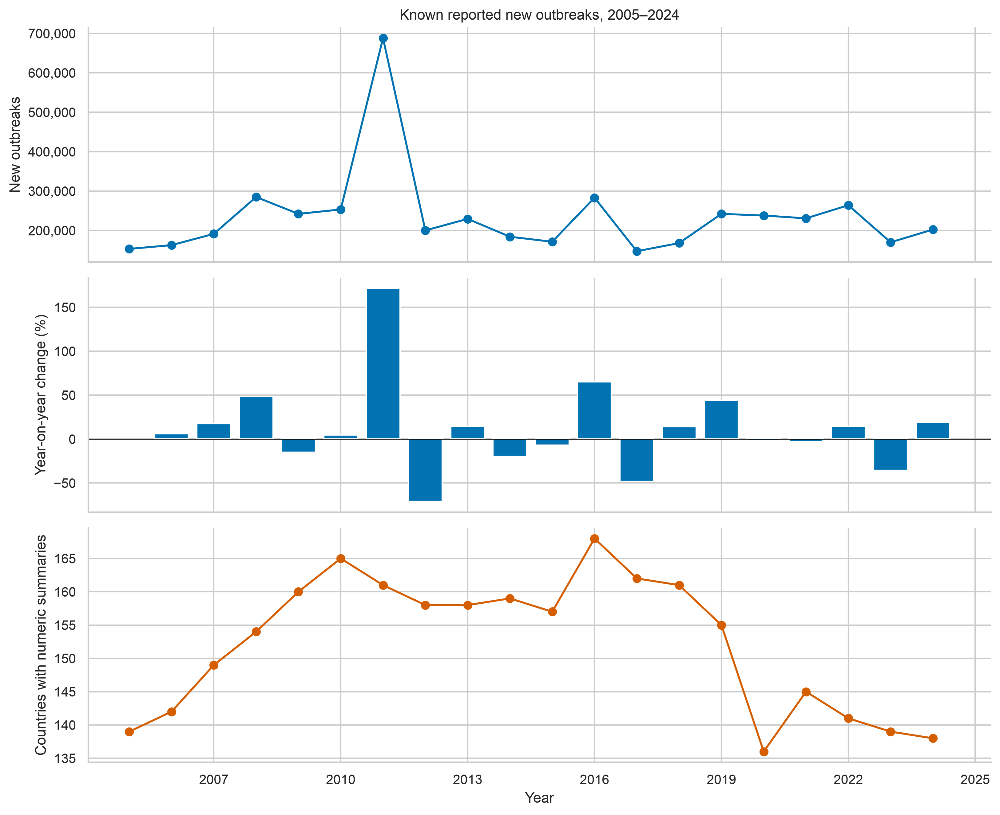

**Research question:** How do reported counts and coverage change annually?

**Method:** Sum known selected New outbreaks by Year; percentage change uses consecutive observed years without filling missing counts.

**Observation:** 2011 peaks at 688,141; Iran / Paenibacillus larvae (American foulbrood) contributes 66.7% of that total.

**Interpretation:** Use the peak and coverage changes to choose periods for disease-specific review.

**Limitations:** Unknown groups contribute no numeric count; counts may be partial. Country numbers do not measure complete reporting or livestock exposure.

### 02_semester_trend

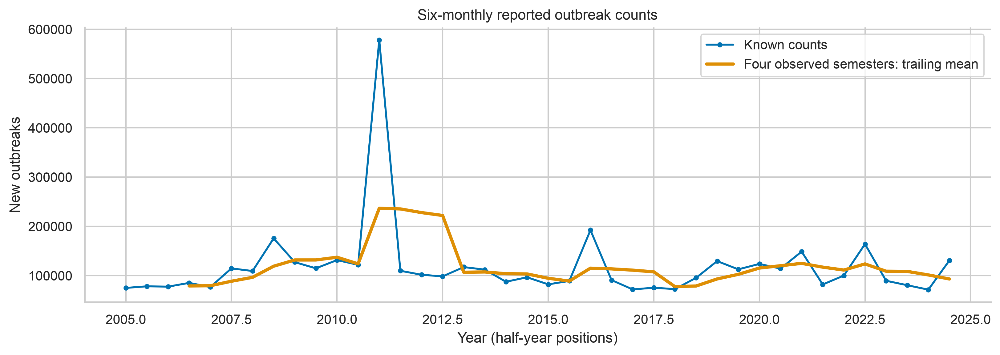

**Research question:** When do six-month reported counts peak?

**Method:** Sum by explicit reporting semester; add a trailing mean of four observed semesters.

**Observation:** 2024 contains 2 semester labels; country coverage is half 1: 129, half 2: 126.

**Interpretation:** Half-year variation can guide finer data requests.

**Limitations:** These are reporting-period counts; precise onset/report dates and monthly seasonality are unavailable. A trailing mean is descriptive.

### 03_top_disease_trends

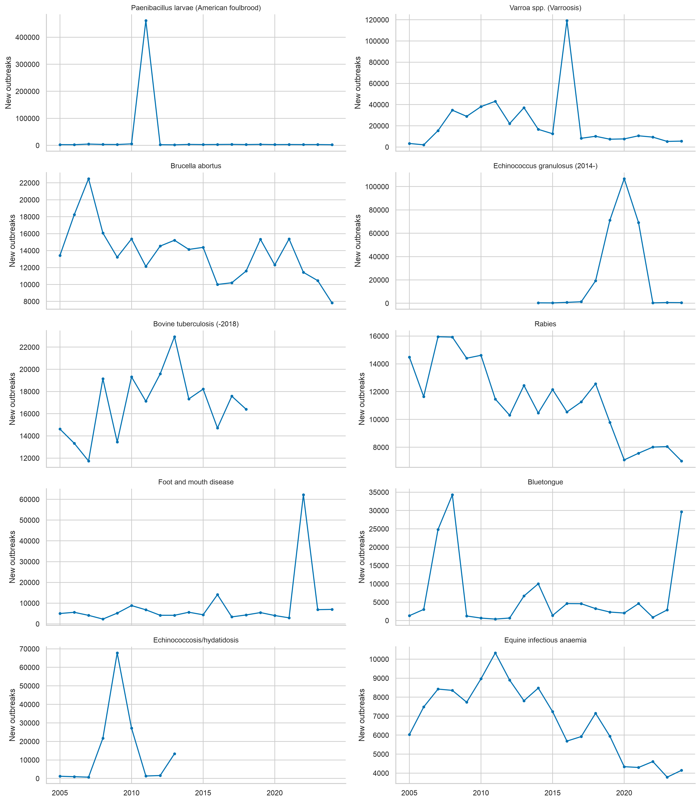

**Research question:** Are high-count diseases stable or dominated by spikes?

**Method:** Use unmerged top ten source labels and separate annual y-axis scales; missing years remain gaps.

**Observation:** The top ten labels account for 54.0% of known counts. See exported series for exact peaks.

**Interpretation:** Separate scales reveal shapes obscured by the global total.

**Limitations:** Disease definitions change over time; no merged HPAI or tuberculosis continuity is assumed. Counts across disease definitions may not represent unique biological events.

### 04_disease_region_ranking

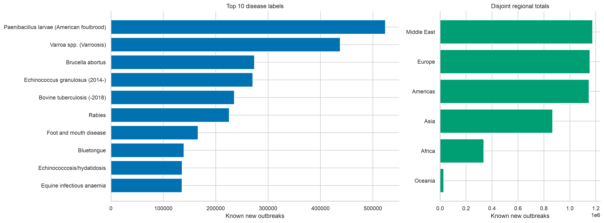

**Research question:** Which diseases and regions contribute most known counts?

**Method:** Sum known counts after verified duplication removal, subtype-preserving selection and category priority.

**Observation:** Paenibacillus larvae (American foulbrood) and Middle East lead their rankings.

**Interpretation:** Prioritise these contributors for source verification and targeted analysis.

**Limitations:** Reported counts reflect reporting and heterogeneous outbreak definitions, not underlying risk; bee animal units must not be confused with outbreak counts.

### 05_region_trends

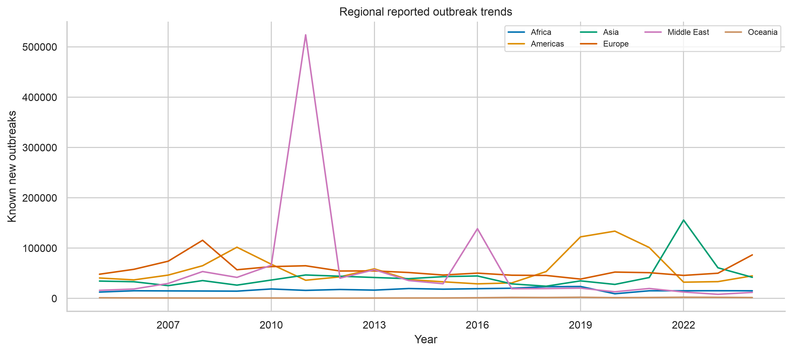

**Research question:** Do regions show different temporal patterns?

**Method:** Annual regional sums with missing region-years left as gaps.

**Observation:** The largest cumulative regional share is Middle East (25.0%).

**Interpretation:** Review regional peaks separately rather than infer a single global trajectory.

**Limitations:** Country participation and administrative coverage vary; regional totals lack population denominators.

### 06_disease_region_heatmap

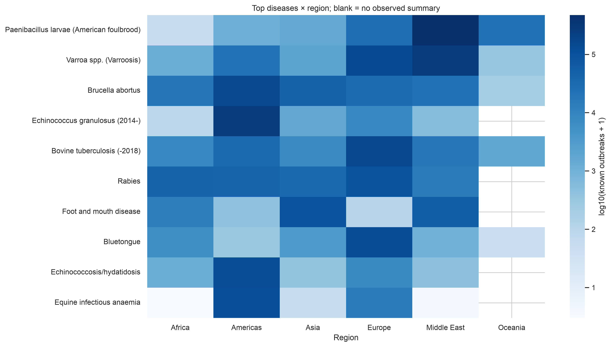

**Research question:** Which top diseases dominate where?

**Method:** Known disease-region counts on log10(count+1); blanks are unobserved, explicit zero remains zero.

**Observation:** Paenibacillus larvae (American foulbrood) is the highest-count source disease label overall.

**Interpretation:** Log colour supports comparison across large differences in scale.

**Limitations:** Colour does not indicate adjusted risk or establish disease absence in blank cells.

### 07_region_composition

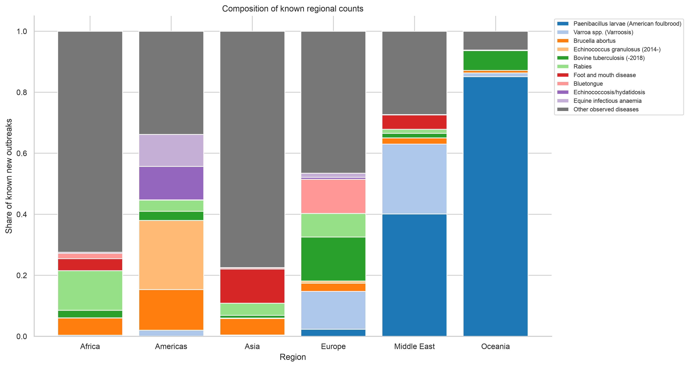

**Research question:** How does the disease mix differ across regions?

**Method:** Shares of each regional known-count total: top ten labels plus all other observed disease labels.

**Observation:** Top ten labels contribute 54.0% globally; regional mixes are in disease_region.csv.

**Interpretation:** Composition is useful for choosing regional disease case studies.

**Limitations:** Shares condition on known counts. Blank combinations add no observed contribution; this does not impute disease absence.

### 08_disease_year_heatmap

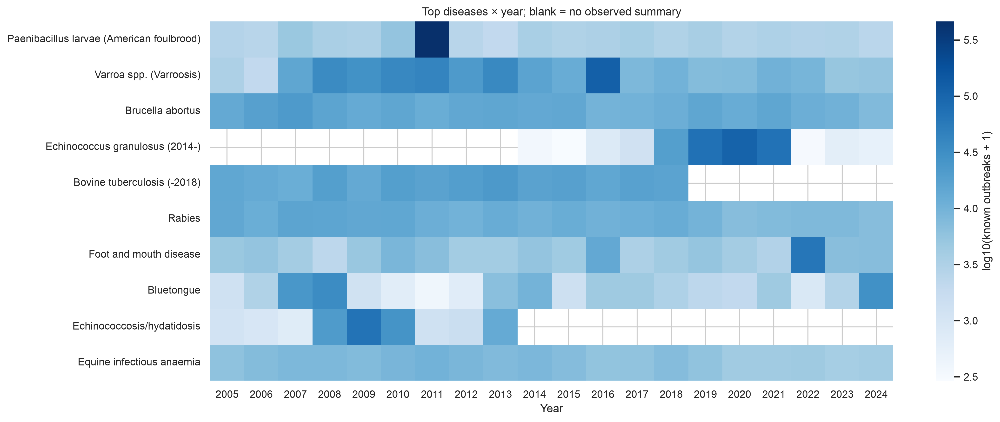

**Research question:** Which high-count diseases have abrupt peaks or changing label coverage?

**Method:** Log10 annual sums for unchanged top source labels, with gaps retained.

**Observation:** The global count peak is 2011; each disease may peak in a different year.

**Interpretation:** Compare concentrated spikes with sustained patterns before selecting a model.

**Limitations:** Renamed or newly introduced labels may create structural gaps; missing data are not zero.

### 09_half_year_patterns

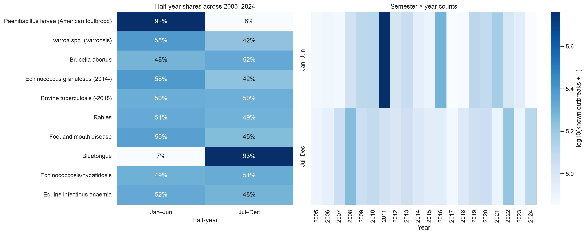

**Research question:** Is the reporting-period distribution uneven?

**Method:** Pool known counts by Jan–Jun and Jul–Dec for top diseases; show semester-year totals separately.

**Observation:** Bluetongue has 92.7% of known counts in Jul–Dec. Shares describe reporting periods, not monthly onset seasonality.

**Interpretation:** Use these contrasts to design region-specific seasonal follow-up.

**Limitations:** Pooled hemispheres, reporting lag, one-off peaks, and incomplete coverage can mimic seasonality. No monthly or significance claim is supported.

### 10_exploratory_anomalies

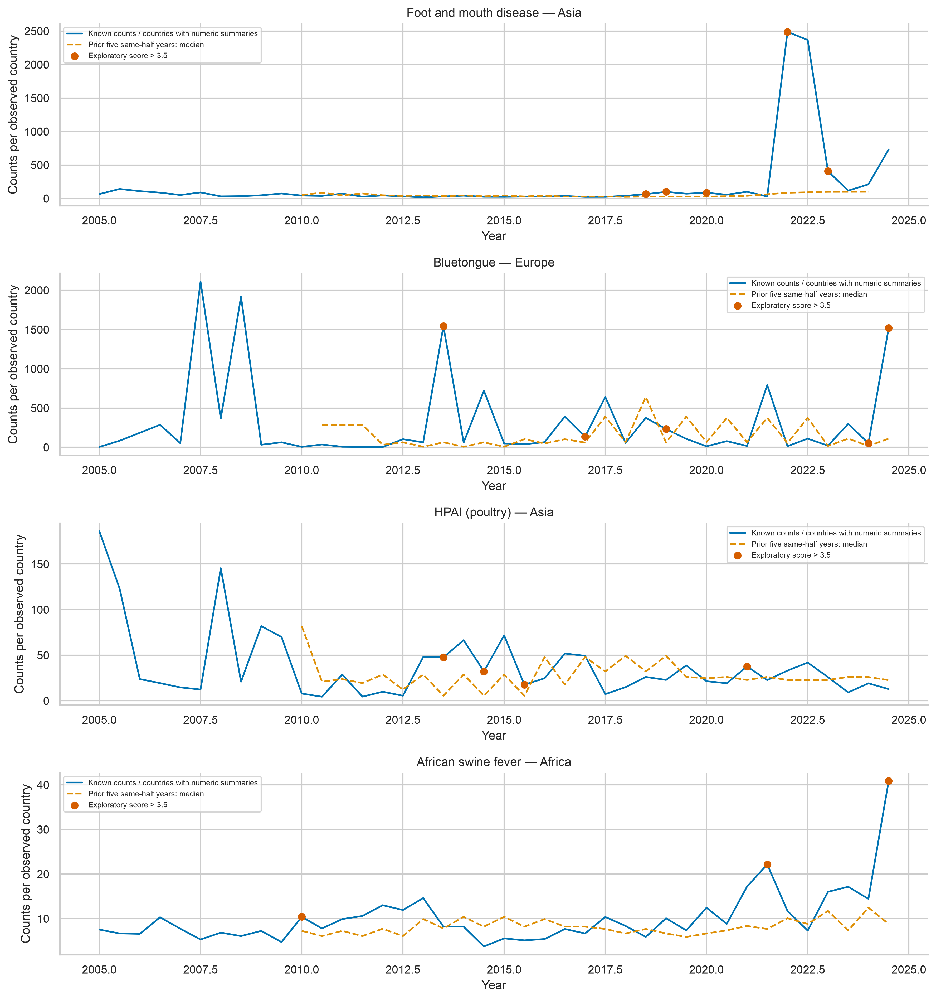

**Research question:** Which recent semester counts depart from their historical same-half baseline?

**Method:** Prior five consecutive same-half years only; log1p(known counts / disease-specific observed countries), median and scaled MAD; screen positive robust scores >3.5. Skip incomplete-count periods and zero MAD.

**Observation:** 467 flags among 6425 eligible comparisons. The figure prioritises selected diseases with at least three observed countries and 50 known counts, one region per disease. For Asia/FMD 2022 half 1, observed counts per reporting country are 2,488.8 versus historical median 85.5 (29.1×); Indonesia contributes 32,078 known counts.

**Interpretation:** Use flags as a reproducible triage list for source review; five points are too few for calibrated tail probabilities.

**Limitations:** No p-values, false-positive calibration, causal inference or forecast validation. Country composition may change, denominator is a reporting proxy, and excluded ambiguous groups can lower counts.

### 11_country_ranking

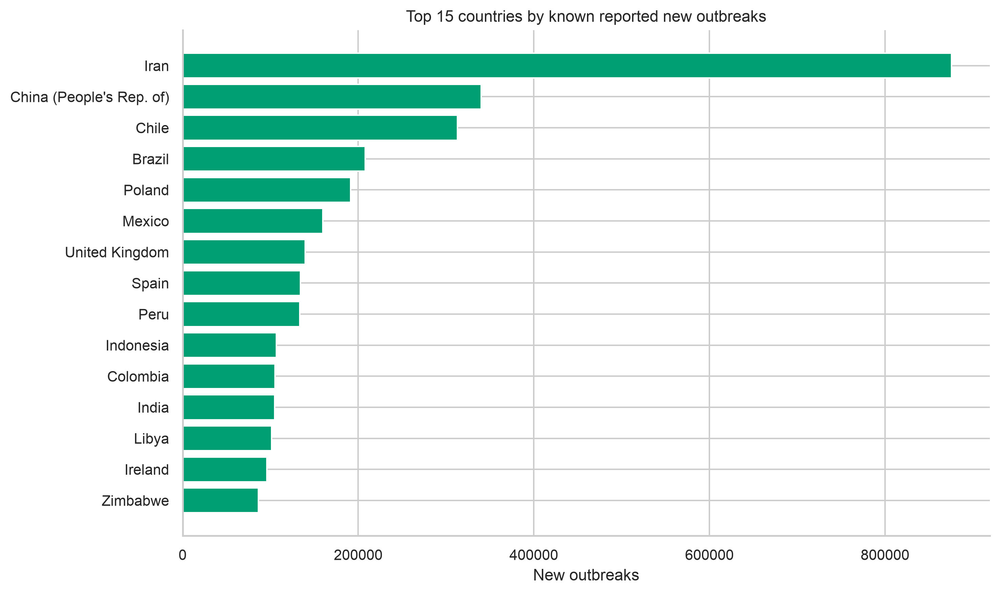

**Research question:** Are known counts concentrated in a few countries?

**Method:** Rank cumulative known country counts after regional de-duplication.

**Observation:** The top five countries account for 41.0%.

**Interpretation:** Concentration motivates country-level sensitivity checks.

**Limitations:** No livestock denominators, comparable surveillance capacity or uniform outbreak definition.

### 12_priority_disease_regions

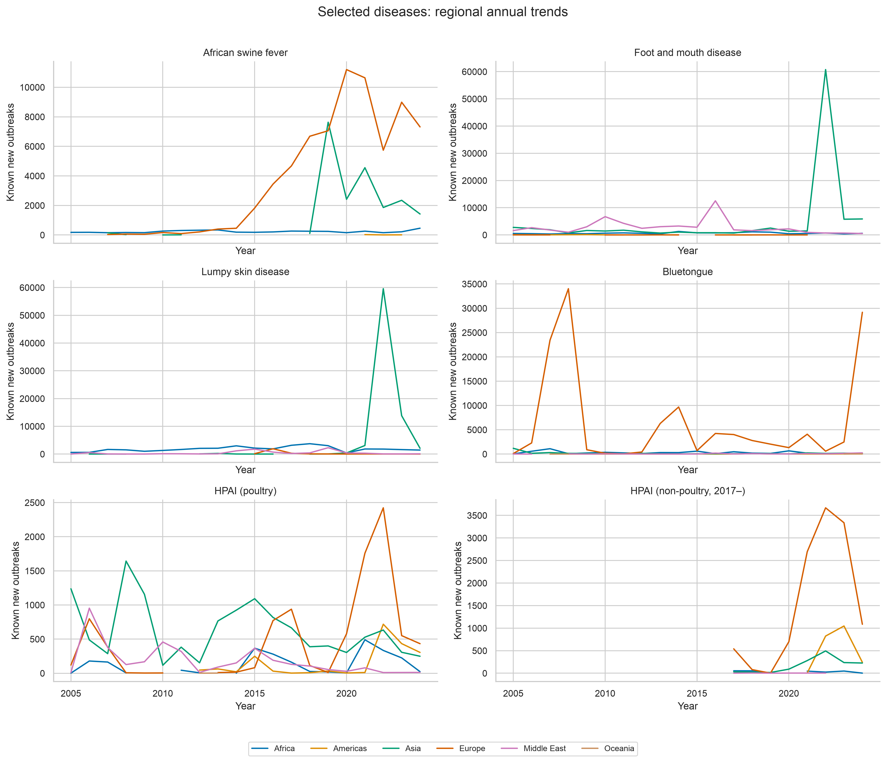

**Research question:** Which regions drive changes in selected diseases?

**Method:** Separate annual regional sums for six observed source disease labels; HPAI categories remain separate; no absent years are filled.

**Observation:** Peak observed global years: African swine fever: 2021 (15,477); Foot and mouth disease: 2022 (62,180); Lumpy skin disease: 2022 (61,433); Bluetongue: 2008 (34,276); HPAI (poultry): 2022 (4,118); HPAI (non-poultry, 2017–): 2022 (5,014).

**Interpretation:** These peaks identify focused disease-region case studies for Challenge 6.

**Limitations:** Coverage and source definitions change; the non-poultry HPAI label begins in 2017 and cannot be compared with an invented pre-2017 zero baseline.

## Integration with Parts 1 and 2

There is no saved cleaned WAHIS summary dataset. Export `data/cleaned_summary.csv` with the original required columns listed in `analysis.py`, including subtype and category, and `is_synthetic_summary` where applicable. Keep missing New outbreaks missing; do not infer zeros. Use --input for another path. The EDA validates, reselects and audits this input without modifying it. A Both-only export cannot reconstruct category summaries already discarded; its scope will differ from the raw prefer-both fallback. Confirm the final summary policy and subtype additivity with teammates before adopting presentation totals.

## Climate feasibility and follow-up

Complete existing climate coverage matches 5,756 of 5,793 observed country-semesters (99.36%). Unmatched countries: Cayman Islands, French Guiana, Guadeloupe, Martinique, Mayotte, Reunion. Full provenance and shared ISO3 mappings are in output/audit.json.

The existing monthly climate file is usable for six-month country-level joins only when all six months and variables are present. Shared ISO3 mappings (historical territories or subdivisions) need adjudication; do not combine WAHIS counts blindly by ISO3. Other climate CSVs were inspected but not mixed into this join. No association is claimed from match coverage.
Next: resolve ambiguous summary counts and obtain the WOAH dictionary; validate top country reports and renamed disease definitions; estimate disease-region negative-binomial trends with disease-specific reporting and exposure denominators, residual checks and multiplicity control; assess half-year effects by hemisphere; obtain onset dates for monthly seasonality. For climate, use country/half-year fixed effects, temperature and rainfall anomalies, contiguous semester lags and country-clustered inference, then time-ordered holdout validation with baselines/thresholds fitted on training data only. Assess associations separately from causal or predictive claims.

Challenge 6 relevance: annual/disease/regional series describe reported trends; coverage and selection sensitivity distinguish measurement changes from plausible epidemiological signals; the trailing historical baseline provides an interpretable review list. These are retrospective exploratory outputs, not operational early-warning thresholds.